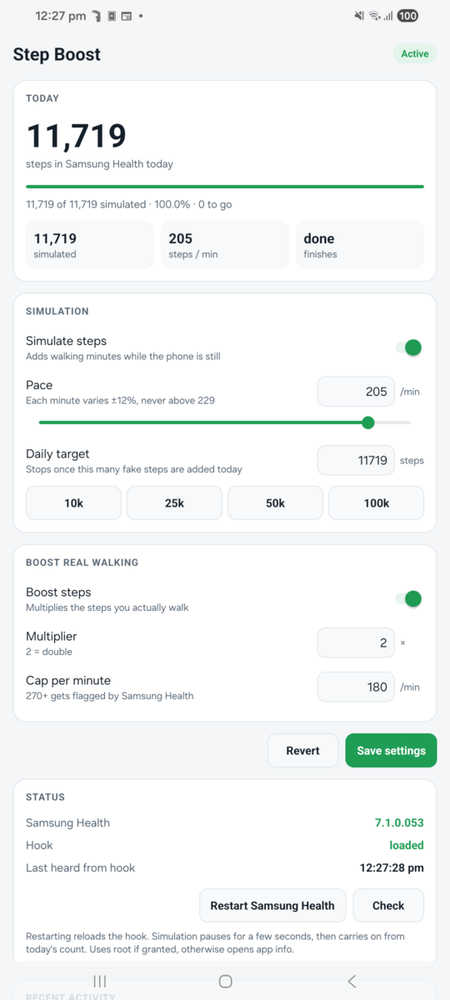
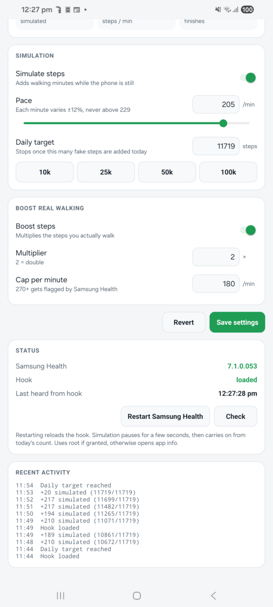

# Samsung Health Step Boost

A Vector / LSPosed (Xposed) module for **rooted** Samsung phones that changes the step data Samsung Health records. It was built for a friendly "anything goes" step challenge between friends who knew about it.

> ✅ **Tested on Samsung Health 7.1.0.**

It does two things, both controlled from its own settings app:

- **Boost**: multiplies the steps you actually walk (default ×2).
- **Simulate**: adds walking minutes while the phone sits still, up to a daily target.

Both feed Samsung Health's own pedometer pipeline, the same path the phone's step sensor uses. The steps show up as normal phone-recorded steps in the daily total, Daily activity and Together challenges. Steps imported through Health Connect don't count in challenges, which is why this hooks Samsung Health directly.

## The app

Open **Step Boost** from your launcher, or tap the module's settings icon in Vector/LSPosed.

<p align="center">
  
  &nbsp;
  
</p>

- **Today:** Samsung Health's step total, read live from the app, plus progress toward the daily target, simulated steps so far, current pace and estimated finish time. It warns you if the target can't be reached before midnight.
- **Simulation:** on/off switch, pace (20–229 steps/min, as a slider or typed in) and daily target, with 10k / 25k / 50k / 100k shortcuts.
- **Boost real walking:** on/off switch, multiplier and cap per minute.
- **Status:** Samsung Health version (flags untested versions), whether the hook answers, and when it was last heard from. A button restarts Samsung Health (using root, or opening app info if root isn't granted).
- **Recent activity:** each simulated or boosted minute as it happens.

The switches save as soon as you flip them. Numbers save with **Save settings**, and the hook picks them up within seconds. The app follows your phone's light or dark mode. The app itself doesn't need root.

## How it works

Samsung Health saves steps in one-minute buckets (`PedometerSContextManager$SContextPedometerData`). The phone's sensor hub and the passive health-services feed both build one per minute, and hand it to the real-time data manager (`iyp.m(...)`), which writes it with `makeHealthData()`.

| Part | Where | What it does |
|---|---|---|
| Boost | `SContextPedometerData.makeHealthData()` (after) | Rewrites the saved record: steps × multiplier, with distance, calories and speed scaled to match. The original object is left alone, so a minute saved twice is never boosted twice. |
| Simulate | Background thread in the `:remote` process (where `PedometerService` runs) | Once a minute, builds a bucket of walking steps and passes it to `iyp.g().m(...)`, the same call the real sensor uses. |
| Today's total | `TodayDataManager.d(DayStepData, …)` (`q940`) | Reads the combined day count whenever Samsung Health refreshes it. |
| Settings | App → hook | The app saves to shared preferences, which LSPosed/Vector makes readable to the hook (`XSharedPreferences`). |
| Progress | Hook → app | The hook sends an explicit broadcast to the app for every simulated or boosted minute and every total change. The app pings the hook when it opens, to check it's alive and to make it reload settings. |

**Keeping the numbers believable:**
- Boosted minutes are capped (default 180 steps/min) and are never lowered below the real count.
- Simulated minutes vary ±12% around the chosen pace and are capped below 230 steps/min. Samsung Health logs and reports minutes with 270 or more steps.
- Simulated distance uses a 0.72 m stride and about 0.04 kcal per step. Speed is calculated with Samsung Health's own helper.

## Requirements

- Rooted Samsung phone with Zygisk, plus [Vector](https://github.com/JingMatrix/Vector) or LSPosed
- Samsung Health 7.1.0
- Android SDK (build-tools 36.0.0 and platform android-35) and JDK 17 or newer, to build

## Install

**Ready-made APK:** download `StepBoost-v2.0.apk` from [Releases](https://github.com/Shantil-K/shealth-step-boost/releases/latest) and install it.

**Or build it yourself:**

```bash
./build.sh                          # builds build/StepBoost.apk (no Gradle needed)
adb install -r build/StepBoost.apk
```

Then:
1. In Vector/LSPosed, enable **Step Boost** and make sure **Samsung Health** is ticked in its scope.
2. Force-stop Samsung Health, or reboot.
3. Open the Step Boost app. The status card should show **Hook: loaded**.

`build.sh` compiles against small stubs of the Xposed API in `stubs/`. They're only used for compiling and aren't packaged, because the framework provides the real classes at runtime.

## Checking the logs

Vector writes module logs to `/data/adb/lspd/log/modules_*.log`:

```bash
adb shell su -c 'grep -h StepBoost /data/adb/lspd/log/modules_*.log | tail'
```

```
StepBoost: hooked com.sec.android.app.shealth:remote
StepBoost: config from app
StepBoost: +106 simulated (406/8000)
StepBoost: Boost 95 → 180 steps
```

## Fair use

This is for fun on your own device, in challenges where everyone is in on the joke. Don't use it to claim rewards, discounts, insurance benefits or workplace wellness incentives that depend on real activity. That's fraud, not a prank.

Not affiliated with or endorsed by Samsung. "Samsung Health" is a trademark of Samsung Electronics.

## License

[GNU General Public License v3.0](LICENSE)
